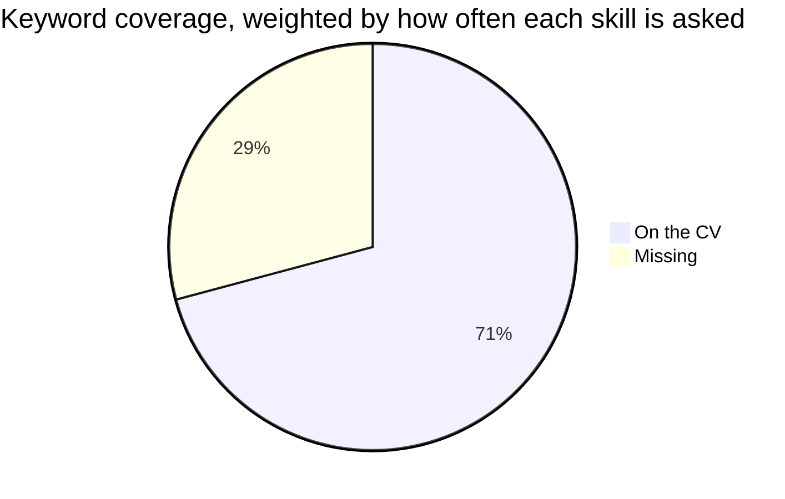
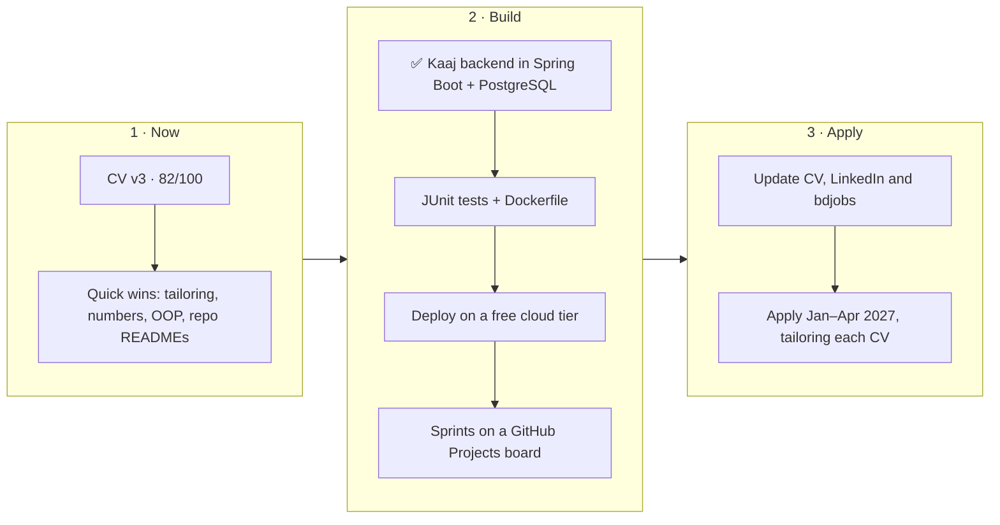
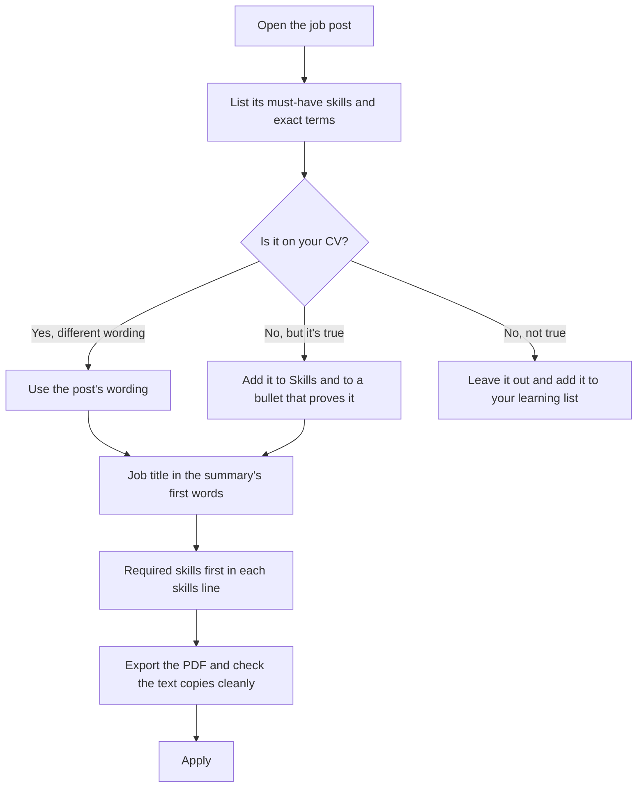

<div align="center">

# 📄 CV Review & ATS Report

**Ahsan Habib · Backend Developer / Software Engineer · reviewed November 2026**


**[📄 View the CV (PDF)](Ahsan_Habib_CV.pdf) · [📝 LaTeX source](Ahsan_Habib_CV.tex)**

</div>

> [!IMPORTANT]
> **Bottom line:** the formatting already scores full marks, and version 3 adds the Kaaj project in **Spring Boot and PostgreSQL**, closing the two biggest keyword gaps (78 → 82). The remaining 18 points are content: numbers in the experience bullets, testing, Docker, cloud and Agile, and tailoring to each post.

## 📑 Contents

| Section | What's inside |
|---|---|
| [📊 ATS Scorecard](#-ats-scorecard) | Overall score, the five scored areas, and the parse checks |
| [✅ ATS-Friendly CV Checklist](#-ats-friendly-cv-checklist) | The 7-point checklist and the 4 questions to ask |
| [🔑 Keyword Analysis](#-keyword-analysis) | 19 skills from six Dhaka backend posts, and which are on the CV |
| [🚀 How to Improve Your ATS Score](#-how-to-improve-your-ats-score) | Quick wins, bigger wins, tailoring, formatting rules |
| [📈 Score Projection](#-score-projection) | How the score rises as each gap closes |
| [🔧 What Changed in the CV](#-what-changed-in-the-cv) | Changes in versions 1, 2 and 3 |
| [🆚 Lessons from the Two Sample CVs](#-lessons-from-the-two-sample-cvs) | What to copy and what to avoid |
| [📝 Editing the CV](#-editing-the-cv) | Update the CV in Overleaf without breaking the ATS checks |
| [📚 Sources](#-sources) | The job posts behind the keyword analysis |

---

## 📊 ATS Scorecard

| Area | Weight | Score | Bar | Why |
|---|:---:|:---:|:---|---|
| Parsing & format | 25% | **10/10** | `██████████` | One column, real text with real spaces, standard fonts and headings, no tables or icons |
| Sections & contact | 10% | **10/10** | `██████████` | Name, phone, email, LinkedIn, GitHub and both job date ranges parse |
| Keyword match | 35% | **7/10** | `███████░░░` | Has 13 of the 19 skills six Dhaka backend posts ask for (71% weighted), now including Spring Boot and PostgreSQL |
| Measurable results | 15% | **6/10** | `██████░░░░` | Research and projects have numbers; the two jobs have none |
| Readability & length | 15% | **9/10** | `█████████░` | One page, consistent dates and tense; dense but easy to skim |
| **Overall** | **100%** | **82/100** | `████████░░` | Formatting is maxed out; numbers in the jobs and testing/DevOps keywords hold it back |

<details>
<summary><b>🧮 How the score is calculated</b></summary>

<br>

Each area is scored out of 10, then weighted. Keywords carry the most weight because keyword matching is what ATS ranking runs on.

```text
  25 × 1.00   parsing & format
+ 10 × 1.00   sections & contact
+ 35 × 0.71   keyword match (51 of 72 weighted points)
+ 15 × 0.60   measurable results
+ 15 × 0.90   readability & length
= 82.3  →  82 / 100      (version 2: 42 of 72 points, 77.9 → 78)
```

</details>

<details>
<summary><b>🔬 Parse checks run on the PDF</b></summary>

<br>

The CV was read back the way a parser reads it, character by character (re-checked for version 3):

| Check | Result |
|---|---|
| Pages | 1 (A4), checked on every build by the GitHub Action |
| Links intact | 18 |
| Ligature or garbled glyphs | 0 |
| Glued words | 0 (the only wide gaps separate titles from their right-aligned dates) |
| Sections detected | Summary, Experience, Education, Technical Skills, Projects, Research |
| Contact details detected | Email, phone, LinkedIn, GitHub |
| Job date ranges parsed | `Aug 2025 – Mar 2026`, `Jun 2024 – Sep 2025` |
| Fonts | Embedded, with Unicode maps |

</details>

> [!NOTE]
> ATS scores aren't standardized: every tool, and every job post, weighs keywords differently. Treat 82 as a benchmark against the six posts in [Sources](#-sources), not a universal number.

---

## ✅ ATS-Friendly CV Checklist

| Checklist item | Status | Note |
|---|:---:|---|
| Job description analysis | 🟡&nbsp;Partly | Matched to six Dhaka backend posts in general, not yet to a specific job |
| Relevant keywords | 🟢&nbsp;Mostly | 13 of 19 recurring skills (71%) |
| Target role alignment | 🟢&nbsp;Yes | Summary, titles, skills and the first project (Kaaj: Java, Spring Boot, PostgreSQL) all point to backend |
| Professional summary | 🟢&nbsp;Yes | Three specific lines; could also state how long you've done backend work |
| Skills optimization | 🟢&nbsp;Mostly | Grouped, backend first; Arduino, ESP32 and x86 Assembly add little for backend roles |
| Experience presentation | 🟡&nbsp;Partly | Clear titles, dates and verbs, but no numbers |
| Clean, ATS-readable format | 🟢&nbsp;Yes | Verified by text extraction |

**The four questions to ask before sending a CV**

- [x] Is the important information clearly structured?
- [x] Is it readable by both ATS and recruiters?
- [ ] Is it relevant to my target job? → yes for backend roles in general; tailor it to each post
- [ ] Does it contain relevant keywords? → 71% today; see the gaps below

---

## 🔑 Keyword Analysis

Skills that six Dhaka backend job posts ask for, weighted by how many of the posts ask for each one.



| Skill | Asked in | On CV |
|---|:---:|:---:|
| Git | 6 / 6 | ✅ |
| REST APIs | 6 / 6 | ✅ |
| SQL / relational databases | 6 / 6 | ✅ |
| CI/CD | 5 / 6 | ✅ |
| **Backend framework** (Spring Boot, Laravel, NestJS, Django) | 5 / 6 | ✅ Spring Boot (v3) |
| PostgreSQL | 4 / 6 | ✅ (v3) |
| Unit testing / TDD | 4 / 6 | ❌ |
| Microservices | 4 / 6 | ❌ |
| Agile / Scrum | 4 / 6 | ❌ |
| Cloud (AWS, Azure, GCP) | 4 / 6 | ❌ |
| Java | 3 / 6 | ✅ |
| PHP | 3 / 6 | ✅ |
| Python | 3 / 6 | ✅ |
| MongoDB / NoSQL | 3 / 6 | ✅ |
| HTML / CSS / JavaScript | 3 / 6 | ✅ |
| OOP | 3 / 6 | ❌ |
| Docker | 2 / 6 | ❌ |
| Multithreading | 2 / 6 | ✅ |
| Authentication / API security | 2 / 6 | ✅ |

> [!TIP]
> Microservices is the one gap you can leave for now. In the two junior posts it was a responsibility or a nice-to-have, not a requirement.

<details>
<summary><b>📋 What each job post asked for</b></summary>

<br>

| Post | Key requirements |
|---|---|
| **6sense Technologies** · Junior Backend Engineer · Dec 2025 | Node.js, NestJS, MySQL, MongoDB, schema design and query optimization, RESTful APIs, authentication, API security, Git, CI/CD; responsibilities also mention Docker, microservices, testing and Agile/Scrum |
| **Eskimi** · Junior Software Engineer (Java/Scala or PHP) · Nov 2025 | Basic Java, Scala or PHP, SQL or NoSQL, Git; preferred REST APIs, microservices, cloud and Agile; internships and personal projects count as experience |
| **Polygon Technology** · Software Engineer (Spring Boot + Laravel) | Spring Boot, Laravel, OOP, MVC, RESTful API design, MySQL/PostgreSQL, Git, CI/CD; preferred HTML/CSS/JavaScript and Agile/Scrum |
| **ZXY International** · Junior Software Developer · 2025 | Python or PHP, HTML/CSS/JavaScript, React or Vue, MySQL/PostgreSQL, ORM tools, Git; preferred Django, Flask, Laravel, cloud, RESTful APIs, Agile and CI/CD |
| **Giga Tech** · Software Engineer (Back-End) · 2023 | Python, Django/FastAPI, REST, threading, OOP, data structures and algorithms, system design, CI/CD (GitHub Actions), PostgreSQL, unit testing, Docker, message queues, microservices |
| **eGeneration** · Software Engineer (Java) · 2021 | Java, Spring Boot, Spring Security, Spring Data, REST, microservices, JPA/Hibernate, PostgreSQL, multithreading, design patterns, TDD, Git |

</details>

---

## 🚀 How to Improve Your ATS Score

### ⚡ Quick Wins

*No new projects needed.*

- [ ] **Tailor the CV for each application.** Put the post's job title at the start of the summary, use its exact terms, and move its required skills to the front of each skills line. Keep the current version as the master copy.
- [ ] **Add real numbers to both jobs.** Use only numbers you actually know (see the questions below).
- [ ] **State your experience length.** "Over a year of paid backend experience" is true (Jun 2024 – Sep 2025). All six posts mention years of experience, and Eskimi's counts internships.
- [ ] **Add keywords you can already defend.** OOP (from your Java, C++ and Kotlin work) and data structures and algorithms; Postman or Linux only if you use them.
- [ ] **Make names match.** The CV says *BRACU Routine Builder* but the repo is `BRACU_RoutineMaker`, so rename one.
- [ ] **Polish the linked repos.** Give each a README covering what it does, the stack and how to run it, and pin the four main projects on your GitHub profile.
- [ ] **Sync LinkedIn and bdjobs.** Use the same title, summary and skills. Employers who find you on bdjobs may see that profile instead of your PDF.
- [ ] **Update after graduation.** Replace "final-year student" and "Expected Fall 2026" with your graduation month.

<details>
<summary><b>💡 Questions that turn into numbers for your experience bullets</b></summary>

<br>

- How many blog posts, notices or job listings went through the atmabiswas.org dashboard?
- Roughly how many people visit the site each month?
- How long did a deploy take before GitHub Actions, and how long after?
- How many admin features or pages did you build?
- For the club website: how many members, events or registrations does it handle?

Then put the number in the bullet, for example:

```diff
- ...including an admin dashboard for publishing blogs, notices and job postings
+ ...including an admin dashboard used to publish [N]+ blogs, notices and job postings
```

**Note:** `[N]` is a placeholder. Only write a figure you can back up.

</details>

### 🧱 Bigger Wins

*Before the Jan–Apr 2027 job hunt.*

- [x] **Build the Kaaj features in Spring Boot with PostgreSQL.** Done in version 3: job posting and employer verification, 11 REST endpoints ([repo](https://github.com/ahsanauddry027/SpringBoot_PostgreSQL_Api)). It fills the two biggest gaps, a backend framework (5 of 6 posts) and PostgreSQL (4 of 6), and backs up the "Java" on the CV.
- [ ] **Add JUnit tests and a Dockerfile, then deploy on a free cloud tier.** That covers testing (4/6), Docker (2/6) and cloud (4/6), each with proof.
- [ ] **Run the Kaaj team in short sprints on a GitHub Projects board.** Then "Agile/Scrum" (4/6) is a true claim.
- [ ] **Add a LeetCode or Codeforces profile link** once you've built a record there. It gives recruiters something they can check.



### 🎯 Tailor Every Application



<details>
<summary><b>✅ Before-you-apply checklist</b></summary>

<br>

- [ ] The post's job title appears in the summary
- [ ] Every must-have skill you genuinely have is in Skills **and** in a bullet
- [ ] Terms match the post's spelling, e.g. "RESTful API", "MySQL/PostgreSQL"
- [ ] One page, PDF, named `Ahsan_Habib_CV.pdf`
- [ ] The PDF text, pasted into a plain editor, reads in order with no glued words
- [ ] LinkedIn and bdjobs say the same thing

</details>

### 🧾 ATS Formatting Rules

| ✅ Do | ❌ Don't |
|---|---|
| One column, top to bottom | Two columns, sidebars or text boxes |
| Standard headings: Summary, Experience, Education, Skills, Projects | Creative headings like "My Journey" |
| Text-based PDF, or .docx when a portal asks for Word | Scanned or image-only CVs |
| Contact details in the main body | Contact details only in a page header or footer |
| Job dates like `Jun 2024 – Sep 2025` | Seasons or unclear formats for job dates |
| Plain bullets and standard fonts | Icons, skill bars, star ratings or tables for layout |
| Visible URLs for LinkedIn and GitHub | Links hidden behind icons |
| File name `Ahsan_Habib_CV.pdf` | File name `cv_final_v3.pdf` |

### 🚫 What to Avoid

- **Skills you can't explain in an interview, and keyword stuffing.** A recruiter reads every CV on the shortlist.
- **Hidden keywords** in white or tiny text. Parsers and recruiters both catch it.
- **Two-column layouts, text boxes, icons and skill bars.** They confuse ATS parsers.

> [!CAUTION]
> An ATS-friendly CV isn't a magic formula. It doesn't guarantee an interview or a job; it makes sure your relevant experience is read correctly when you're screened.

---

## 📈 Score Projection

Same rubric, adding each improvement in order. **Only add what's true.**

| Step | Change | Keyword match | Score |
|:---:|---|:---:|:---:|
| 0 | CV version 2 | 42/72 · 58% | 78 |
| ✅ 1 | + Spring Boot and PostgreSQL (Kaaj backend) · **CV version 3, today** | 51/72 · 71% | **82** |
| 2 | + OOP, if you can defend it | 54/72 · 75% | 84 |
| 3 | + real numbers in both jobs | 54/72 · 75% | 87 |
| 4 | + unit tests (JUnit) | 58/72 · 81% | 89 |
| 5 | + Docker | 60/72 · 83% | 90 |
| 6 | + cloud deployment | 64/72 · 89% | 92 |
| 7 | + Agile/Scrum (sprints) | 68/72 · 94% | **94** |

<details>
<summary><b>Assumptions behind the projection</b></summary>

<br>

- Step 3 assumes real numbers raise *Measurable results* from 6/10 to 8/10.
- Each keyword step assumes the skill appears in Skills **and** in a bullet that proves it.
- Microservices (the last 4 of 72 points) is left out on purpose; see the tip in [Keyword Analysis](#-keyword-analysis).

</details>

---

## 🔧 What Changed in the CV

<details>
<summary><b>Version 1: rebuilt on the stronger sample CV's structure</b></summary>

<br>

- Section order: Summary → Experience → Education → Technical Skills → Projects → Research
- Centered header, uppercase colored section headings with rules, and one-line role headers with right-aligned dates
- A *Technologies:* line under each project, with GitHub links kept for every project
- New three-line summary aimed at backend roles
- Internship split into three bullets: build, security and deployment
- The Routine Builder's REST API and caching got their own bullets
- Skills regrouped: Languages · Backend & Databases · Security & DevOps · Frontend & Mobile · Systems & ML
- Trimmed to fit one page: the VC's List GPA explanation and the paper's full title and author list
- ATS fixes: real space characters in the PDF, no ligature glyphs, Unicode font maps, and PDF title, author and keywords

</details>

<details>
<summary><b>Version 2: professional wording and keywords</b></summary>

<br>

- Summary opens with "Backend developer" and spells out searchable terms: session-based authentication, RESTful APIs, CI/CD pipeline
- Varied action verbs; five bullets used to start with "Built"
- Skills now name what the work already shows: HTML/CSS, caching, input validation, multithreading
- Nothing invented: every claim is backed by the original CV

</details>

<details>
<summary><b>Version 3: Spring Boot and PostgreSQL (Kaaj)</b></summary>

<br>

- New first project, **Kaaj Job Platform: Spring Boot REST API** (CSE471, team of 3): 11 RESTful endpoints for job posting and employer verification with Java, Spring Boot and Spring Data JPA on PostgreSQL in a layered MVC design; a job-status state machine with 10 service-layer rules; admin verification with validated uploads. Every claim comes from the [repo's README](https://github.com/ahsanauddry027/SpringBoot_PostgreSQL_Api)
- Summary now opens with "building RESTful APIs with Java, Spring Boot and PostgreSQL"
- Skills split into **Backend** (Spring Boot, Spring Data JPA (Hibernate), Node.js, Express, RESTful APIs, caching, Maven, Postman) and **Databases** (PostgreSQL, MySQL, MongoDB); PDF keywords updated to match
- Kept to one page: TrackAlert moved to *Other projects* (keeping "led a team of 5"), and the Routine Builder, Process Manager and compiler bullets were tightened
- *Other projects* links VangtiChai instead of Bigger Number Game, whose README has an unprofessional pop-up message
- A GitHub Action now compiles the LaTeX with pdfLaTeX, refuses a PDF longer than one page, and commits `Ahsan_Habib_CV.pdf`

</details>

---

## 🆚 Lessons from the Two Sample CVs

Two "selected" CVs shared on social media were scored before rebuilding this one.

| Area | Sample 1 (data analyst) | Sample 2 (software engineer) |
|---|:---:|:---:|
| Header | 5 | 9 |
| Section order | 7 | 9 |
| Readability | 7 | 6 |
| Bullet quality | 4 | 8 |
| Credibility | 3 | 9 |
| **Overall** | **5 / 10** | **8 / 10** |

<details>
<summary><b>What to copy and what to avoid</b></summary>

<br>

**Copy from Sample 2**
- One-line contact header and Experience near the top
- Projects with GitHub links and a *Technologies:* line
- Achievements a recruiter can check: coding ratings, user counts, selection rankings
- The bullet pattern: action → tech → number

**Avoid from Sample 1**
- Leftover template placeholders and vague link labels
- Inflated claims you can't explain in an interview
- Accuracy as the headline metric for imbalanced problems like fraud detection; report precision and recall instead
- Filler such as beginner certificates and soft-skill lists

**Don't copy from Sample 2:** its cramped font and margins, or strong bullets with no numbers.

</details>

---

## 📝 Editing the CV

This repo holds the CV as a PDF ([`Ahsan_Habib_CV.pdf`](Ahsan_Habib_CV.pdf)) and its LaTeX source ([`Ahsan_Habib_CV.tex`](Ahsan_Habib_CV.tex)).

**Easiest way:** edit `Ahsan_Habib_CV.tex` on GitHub (or locally) and push. The [Build CV PDF](.github/workflows/build-cv.yml) action compiles it with pdfLaTeX, checks it is still one page, and commits the new `Ahsan_Habib_CV.pdf` for you. If the CV runs onto a second page, the run fails and its warning shows which text spilled over.

<details>
<summary><b>✏️ Update it in Overleaf</b></summary>

<br>

1. Create a blank project in [Overleaf](https://www.overleaf.com) and replace `main.tex` with the contents of `Ahsan_Habib_CV.tex`.
2. Compile with **pdfLaTeX**, Overleaf's default compiler.
3. Next to bold text, links or `|` separators, type `\ssp` instead of a plain space. It prints a normal space and puts a real space character in the PDF, so ATS parsers don't glue words together.
4. Keep it to one page, then download the PDF and save it as `Ahsan_Habib_CV.pdf`.
5. Paste the PDF's text into a plain editor to check it reads in order, then commit both files here.

</details>

---

## 📚 Sources

Job posts used for the keyword analysis, all based in Dhaka:

1. [Junior Backend Engineer – 6sense Technologies](https://hw.glich.co/jobboard/jobs/junior-backend-engineer-at-6sense-technologies-exh437) · Dec 2025
2. [Junior Software Engineer (Java/Scala or PHP) – Eskimi](https://hw.glich.co/jobboard/jobs/junior-software-engineer-javascala-or-php-at-eskimi-8leuz0) · Nov 2025
3. [Software Engineer (Spring Boot + Laravel) – Polygon Technology](https://jobs.smartrecruiters.com/PolygonTechnology/744000065640435-software-engineer-spring-boot-laravel-) · expired, undated
4. [Junior Software Developer – ZXY International](https://hotjobs.bdjobs.com/jobs/zxy/zxy879.htm) · 2025
5. [Software Engineer (Back-End) – Giga Tech](https://gigatechltd.com/?p=12122) · 2023
6. [Software Engineer (Java) – eGeneration](https://www.tbsnews.net/job/software-engineer-java-egeneration-266752) · 2021

---

<div align="center">
<sub>Last updated 4 November 2026 · <a href="#-cv-review--ats-report">Back to top ↑</a></sub>
</div>
